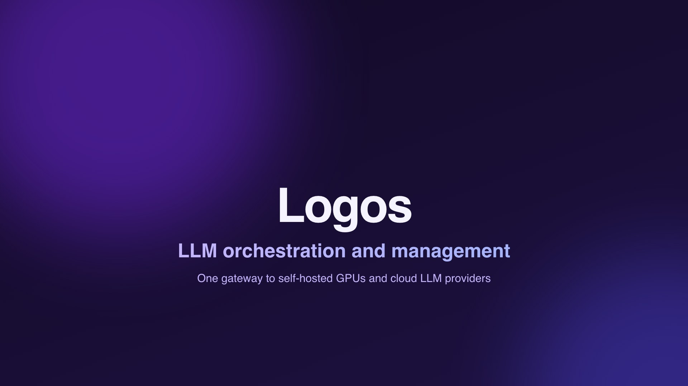
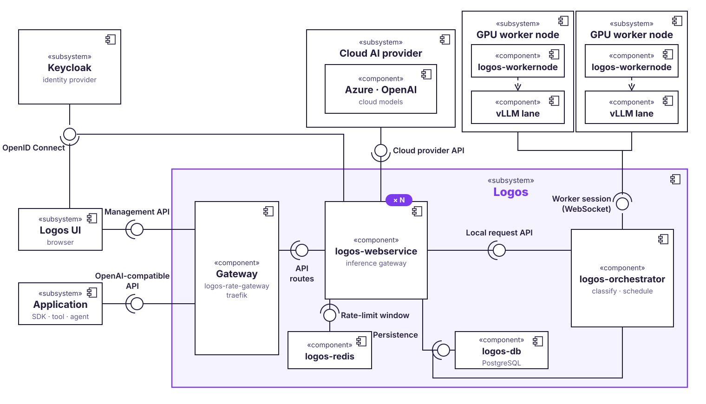

<div align="center">


# Logos

**LLM orchestration and management**

One OpenAI-compatible gateway in front of self-hosted GPU workers and cloud providers,
with policy-based routing, scheduling, usage logging, billing and monitoring.

[](https://github.com/LogosOSS/Logos/actions/workflows/logos_test.yml)
[](https://github.com/LogosOSS/Logos/actions/workflows/logos_lint.yml)
[](https://github.com/LogosOSS/Logos/actions/workflows/logos_e2e.yml)
[](https://logososs.github.io/Logos/)
[](LICENSE)

[Documentation](https://logososs.github.io/Logos/) ·
[User Guide](https://logososs.github.io/Logos/user/getting-started) ·
[Administrator Guide](https://logososs.github.io/Logos/admin/installation) ·
[Developer Guide](https://logososs.github.io/Logos/developer/system-design)

<a href="https://logososs.github.io/Logos/">
  
</a>

<sub>▶ Watch the 60 s trailer on the <a href="https://logososs.github.io/Logos/">documentation homepage</a>.</sub>

</div>

## Why Logos

- **One API for every model.** Clients use the OpenAI APIs they already know — Chat Completions,
  Responses, audio, files and batches — against one endpoint, whether the model runs on your own
  GPUs or at Azure or OpenAI.
- **Policies decide where a request goes.** Routing weighs privacy, priority, cost and quality, so
  sensitive data stays on self-hosted workers and cheap requests do not land on expensive models.
- **Your GPUs, fully used.** The orchestrator schedules requests across vLLM lanes on worker nodes,
  wakes and sleeps lanes on demand and calibrates VRAM profiles automatically.
- **Teams, keys and budgets.** Every request belongs to a team and an API key, with per-model
  permissions, monthly budgets and rate limits.
- **Everything is measured.** Requests, tokens, cold starts and cloud cost are logged and shown live;
  nightly benchmarks keep latency and throughput numbers current.
- **Spare capacity does work.** Coding agents run in isolated containers on capacity that interactive
  traffic leaves unused.

## Quick links

| | |
| --- | --- |
| Documentation | https://logososs.github.io/Logos/ |
| Call the API | [User Guide → API usage](https://logososs.github.io/Logos/user/api-usage) |
| Install and operate Logos | [Administrator Guide](https://logososs.github.io/Logos/admin/installation) |
| Add a GPU worker node | [Worker node](https://logososs.github.io/Logos/admin/worker-node) |
| System design and architecture | [System design](https://logososs.github.io/Logos/developer/system-design) · [Architecture reference](https://logososs.github.io/Logos/developer/architecture) |
| What each role can do | [Logos Admin](https://logososs.github.io/Logos/roles/logos-admin) · [App Admin](https://logososs.github.io/Logos/roles/app-admin) · [App Developer](https://logososs.github.io/Logos/roles/app-developer) |
| Local development setup | [Developer Guide → Local setup](https://logososs.github.io/Logos/developer/local-setup) |
| Security policy | [SECURITY.md](SECURITY.md) |
| Code of conduct | [CODE_OF_CONDUCT.md](CODE_OF_CONDUCT.md) |
| Report a bug or request a feature | [Issues](https://github.com/LogosOSS/Logos/issues/new/choose) |

## Try it

Run the full stack locally from the repository root, then start the web application:

```bash
docker compose -f docker-compose.dev.yaml up --build
cd logos-ui && npm ci && ng serve
```

Open [http://localhost:4200](http://localhost:4200) and select **Sign in**. The local Keycloak realm
(`keycloak/tum-realm.json`) seeds these accounts, all with the password `password`:

| Username | Role | Use it for |
| --- | --- | --- |
| `tobias.wasner` | `logos_admin` | Everything, including providers, policies and workers |
| `alexandra.szuminska` | `app_admin` | Teams, users and models |
| `henriette.huhn`, `blub.fisch`, `fridoline.fuchs` | `app_developer` | Using models through a team |
| `pech.vogel` | none | The no-team and no-access screens |

A fresh stack has no teams, so `app_developer` accounts see nothing until they join one.

<details>
<summary><b>Three ways to give developers a team</b></summary>

- **Manually** (default): sign in as `tobias.wasner` or another admin, create a team under **Teams**
  and add the developer accounts as members. They get access on their next login.
- **From a Keycloak group**: as `tobias.wasner`, create a team under **Teams** and set its
  **Keycloak group**, in the create dialog or later on the team's **Settings** tab. Everyone who
  carries that group or realm role joins the team on the next login and leaves it again once they
  no longer carry it. The seeded realm offers `logos-dev` and `maiss-dev`.
- **Automatically**: set `KEYCLOAK_AUTO_PROVISION_TEAMS=true` for `logos-webservice` in
  `docker-compose.dev.yaml`. On the next login, every account with a team role (a role ending in
  `-dev`, `-team` or `-group`, see `KEYCLOAK_TEAM_ROLE_SUFFIXES`) gets that team created and joined.
  The seeded realm maps `logos-dev` → team **Logos** and `maiss-dev` → team **Maiss**.

To add more dev accounts, edit `keycloak/tum-realm.json` and restart the `keycloak` container.
On Linux, if `npm` reports `EACCES` errors, see the
[npm documentation](https://docs.npmjs.com/resolving-eacces-permissions-errors-when-installing-packages-globally).

</details>

The interactive API reference is served at `/docs` (Swagger). A `GET /v1` returns 404 by design.

## Key capabilities

| Area | What it does |
| --- | --- |
| [OpenAI-compatible API](https://logososs.github.io/Logos/user/api-usage) | `/v1/chat/completions`, `/v1/responses`, embeddings and models, streaming included; one API key per team member or application |
| [Audio](#audio-transcription-and-translation) | `/v1/audio/transcriptions` and `/v1/audio/translations` against cloud Whisper deployments or compatible worker backends |
| [Batch processing](https://logososs.github.io/Logos/batch-processing) | The OpenAI Batch API (`/v1/files`, `/v1/batches`); runs at the provider's batch rate where possible, otherwise inside Logos at the lowest queue priority. The **Batches** page does the same without a script |
| Async jobs | `POST /jobs/v1/chat/completions` returns `202` with a `Location` header; poll `GET /jobs/{job_id}` |
| [Decision models](https://logososs.github.io/Logos/decision-models) | `POST /v1/systemone` answers typed questions (yes/no, choice, score) with calibrated probabilities |
| Policies and routing | Select a model and provider per request by privacy, priority, cost and quality |
| [Scheduling and capacity](https://logososs.github.io/Logos/admin/operations) | Queues requests across vLLM lanes; the capacity planner sleeps idle lanes, wakes lanes on demand and tunes GPU memory utilization |
| [Worker nodes](https://logososs.github.io/Logos/admin/worker-node) | GPU machines dial out to the core node over WebSocket, so they need no inbound ports; VRAM profiles are calibrated automatically and stored centrally |
| [Benchmarks](https://logososs.github.io/Logos/admin/model-benchmarks) | Manual benchmarks with saved request datasets, plus a [nightly rotation](https://logososs.github.io/Logos/admin/nightly-benchmarks) that compares batching parameters per model and worker |
| Teams, keys and budgets | Teams with members, application keys, per-model permissions, monthly budgets and rate limits |
| Statistics and billing | Live requests, tokens, cold starts, lane health and cloud cost; spend per team over time |
| [Coding agents](logos-agent/README.md) | Runs coding agents in isolated containers on spare serving capacity; **AI Tools** connects Claude Code or OpenCode in guided steps |
| [Context windows](https://logososs.github.io/Logos/context-windows) | The window follows the KV cache of the serving lane; `GET /v1/models` reports what each model can take |
| [Passkey login](https://logososs.github.io/Logos/passkey-login) | WebAuthn passkey sign-in directly in the web application |

## Architecture

Clients talk to one domain. The webservice terminates the public inference gateway and forwards
local and mixed traffic to the orchestrator, which classifies, schedules and forwards each request.
Worker nodes dial out over WebSocket; cloud providers are called over HTTPS.

<p align="center">
  
</p>

The [system design](https://logososs.github.io/Logos/developer/system-design) covers the deployment
view, the data model and the request flow. The
[request lifecycle reference](logos-orchestrator/src/logos/pipeline/README.md) describes the
classification, scheduling, context-resolution, forwarding and completion boundaries.

## Repository layout

| Directory | Stack | Contents |
| --- | --- | --- |
| [`logos-orchestrator/`](logos-orchestrator) | Python 3.13, FastAPI, uv | Core proxy: authentication, classification, scheduling, provider routing, request logging |
| [`logos-webservice/`](logos-webservice) | Java 25, Spring Boot | Management REST API and public inference gateway (`/v1`, `/openai`, `/jobs`); owns the PostgreSQL schema (Liquibase) |
| [`logos-ui/`](logos-ui) | Angular | Web application for teams, keys, models, statistics and billing |
| [`logos-workernode/`](logos-workernode) | Python | GPU worker-node control plane: vLLM lane lifecycle, calibration, WebSocket bridge |
| [`logos-node-manager/`](logos-node-manager) | Python | Deploys GPU worker nodes |
| [`logos-agent/`](logos-agent) | Python, FastAPI | Runs coding agents in isolated containers |
| [`e2e/`](e2e) | pytest, Playwright | GPU-less end-to-end suite |
| [`docs/`](docs) | Docusaurus | User, administrator and developer documentation |
| `agent-gateway/`, `rate-limit-gateway/` | nginx | Edge proxies around the agent runner and the orchestrator |
| `keycloak/` | — | Development realm |
| `db/` | — | PostgreSQL 17 with pg_cron |
| `benchmarks/`, `scripts/` | Python, bash | Scheduler benchmarks and operations scripts |

| Compose file | Purpose |
| --- | --- |
| `docker-compose.yaml` | Production: pulls pre-built images from Harbor |
| `docker-compose.dev.yaml` | Development: builds all images from source |
| `docker-compose.screenshots.yaml` | Isolated stack for documentation screenshots (see [`docs/AGENTS.md`](docs/AGENTS.md)) |

## Development

### Prerequisites

- Python 3.13 and [uv](https://docs.astral.sh/uv/)
- Docker with Docker Compose
- Node.js and npm for `logos-ui/` and `docs/`
- [Artemis developer access](https://request.aet.cit.tum.de/) to push to this repository

### Orchestrator dependencies

```bash
pip install uv                      # if uv is not installed yet
cd logos-orchestrator
uv sync --locked --python 3.13
```

Run `uv sync --locked` in `logos-orchestrator/` for later syncs. The root `pyproject.toml` only
configures formatting and is not the orchestrator package, so the warning about its missing
`[project]` table is harmless. In PyCharm, use `logos-orchestrator/.venv/bin/python` as the
interpreter; **Sync project** installs missing packages with uv.

### Pre-commit hooks

The [pre-commit](https://pre-commit.com/) configuration runs the same checks as the lint CI job
(`.github/workflows/logos_lint.yml`):

| Hook | Purpose |
| --- | --- |
| `pre-commit-hooks` | YAML/TOML syntax, large files, merge conflicts, end of file, trailing whitespace |
| `autoflake` | Removes unused imports and variables |
| `isort` | Sorts imports (`profile=black`, 120 columns) |
| `black` | Formats Python (`line-length = 120`, `target = py313`) |
| `flake8` | Lints against `.flake8` (E203 and W503 disabled for black) |

```bash
brew install pre-commit             # or: pip install pre-commit
pre-commit install                  # from the repository root; runs the hooks on every commit
pre-commit run --all-files          # what CI runs
pre-commit run black --all-files    # a single hook
```

> [!IMPORTANT]
> The lint CI job fails when a hook changes a file or reports a violation. Fix the issue instead of
> committing with `--no-verify`; CI still fails.

### Conventions

- **Pull request titles** are short, descriptive and start with a capital letter, for example
  `Add team management endpoints`.
- **Commit messages** follow `Logos: Description starting with capital letter (#issue_number)`.
- **Branch names** follow `feature/logos/description` or `logos/description`.
- Every pull request that changes the web application includes desktop and mobile screenshots.
- More rules for contributors and coding agents are in [`AGENTS.md`](AGENTS.md).

## TUM test instance

The test instance runs at `logos-test.aet.cit.tum.de` and is reachable on port 443 for the web
application, the Swagger reference ([`/docs`](https://logos-test.aet.cit.tum.de/docs)) and the
completion API. Traefik routes by path: API paths (`/v1`, `/openai`, `/jobs`, `/api`, `/docs`, …)
win, everything else serves the web application. Port `8080` remains a TLS alias for the completion
API for existing clients.

With access granted and the VPN active, connect with `ssh <tum-id>@logos-test.aet.cit.tum.de`.
The instance lives in `/opt/logos`.

<details>
<summary><b>Database access through an SSH tunnel</b></summary>

PostgreSQL is not reachable from outside the server. Tunnel through SSH, either in your database
client or manually:

```bash
ssh -L 5433:127.0.0.1:5432 <tum-id>@logos-test.aet.cit.tum.de
```

Then connect to `localhost:5433`, database `logosdb`, user `postgres`, password `root`.

In DBeaver, create a PostgreSQL connection. On the **SSH** tab, set host
`logos-test.aet.cit.tum.de`, port `22`, your TUM ID as user name and public-key authentication with
your private key (for example `~/.ssh/id_ed25519`). On the **Main** tab, set host `localhost`,
port `5432`, database `logosdb`, user `postgres` and password `root`.

</details>

## Reference

### Audio transcription and translation

Logos implements the OpenAI-compatible multipart audio APIs:

- `POST /v1/audio/transcriptions` transcribes audio in its original language.
- `POST /v1/audio/translations` transcribes and translates audio into English.

```bash
curl https://logos-test.aet.cit.tum.de/v1/audio/transcriptions \
  -H "Authorization: Bearer $LOGOS_API_KEY" \
  -F "file=@./speech.wav" \
  -F "model=whisper-1" \
  -F "response_format=verbose_json" \
  -F "timestamp_granularities[]=word"
```

<details>
<summary><b>Providers, limits, logging and pricing</b></summary>

The selected model must be available to the caller's API key. Cloud providers (including
deployment-scoped Azure OpenAI Whisper endpoints) and compatible worker-node backends receive the
original multipart fields and file metadata. JSON, verbose JSON, plain text, SRT and VTT responses
are relayed with the upstream status and content type.

Audio file contents and credentials are excluded from usage logs and durable async-job records;
only the file name, media type and size are recorded.

| Limit | Default | Setting |
| --- | --- | --- |
| Audio file (one per request) | 25 MiB (upstream Whisper limit) | `LOGOS_MAX_AUDIO_UPLOAD_BYTES` |
| Each text form field | 64 KiB | `LOGOS_MAX_AUDIO_FORM_FIELD_BYTES` |
| Total multipart request, checked before the file is spooled | 30 MiB | `LOGOS_MAX_AUDIO_REQUEST_BYTES` |

When the provider reports duration-based usage, Logos stores millisecond precision and applies the
provider's per-second catalogue price, so fractional audio duration is not discarded.

</details>

### Capacity planner

| Setting | Default | Effect |
| --- | --- | --- |
| `LOGOS_CAPACITY_PLANNER_ENABLED` | `true` | Background loop (30 s cycles) that sleeps idle lanes, wakes lanes on demand and tunes vLLM GPU memory utilization. Set it in the `environment` of `logos-orchestrator`. |

Worker nodes calibrate model VRAM profiles (memory when loaded and when sleeping) automatically.
Logos stores the profiles in its database and sends them to each worker at startup, so the workers
keep none on disk and need no extra configuration.

### Nightly model benchmarks

Automatic calibration runs first (05:00–08:00 Europe/Berlin by default); benchmarks use the
remaining time. `LOGOS_MAINTENANCE_MAX_NODES` limits simultaneous maintenance workers, including
manual starts: the default `1` keeps runs sequential, `2` permits 2 workers in parallel. Reserved
workers do not serve normal requests.

Logos admins add model/worker pairs to the nightly rotation under **Model Details → Performance**.
Activation and deactivation both need confirmation, and schedules start disabled.

<details>
<summary><b>Rotation rules</b></summary>

- Test at most **2 enabled pairs per night**, within the maintenance worker limit. Untested pairs
  come first, then the oldest previous attempt. Unavailable pairs are skipped.
- Start configurations between **05:00 and 07:50 Europe/Berlin**. At 08:00, continue only if at
  least 50 % of the measured requests completed successfully.
- Stop after **5 minutes without output or completed requests**. Retry a stalled configuration once
  before 07:50, then skip it if it stalls again.
- Compare the current settings with selected batching-parameter variants on a fixed dataset.
- Restore the original worker configuration after the plan. Results are stored for review; a winning
  configuration is never applied to production automatically.

</details>

The [nightly benchmark guide](https://logososs.github.io/Logos/admin/nightly-benchmarks) covers
activation, selection, limits, deployment, recovery and the API. The
[manual benchmark guide](logos-orchestrator/docs/benchmark-configuration.md) describes the dataset
editor and benchmark batches.

## License

Logos is released under the [MIT License](LICENSE) by TUM Applied Education Technologies.
For the attribution and provenance of the LiteLLM model catalog data, see
[litellm-model-catalog.NOTICE](logos-webservice/src/main/resources/litellm-model-catalog.NOTICE).
