# Logos Admin

The Logos Admin role (`logos_admin`) has full access to the platform. This
includes the operator pages. Logos Admins assign global roles in **Users**. An operator bootstraps the first admin during [installation](../admin/installation.md#first-logos-admin).

The UI shows the role badge "Logos Admin" in the header menu.

## Account settings

Open the user menu and select **Account settings** to manage your personal passkeys.
Follow the shared [account settings procedure](app-developer.md#account-settings).

## Statistics

This page shows the usage of the complete platform: the request volume, the
token counts and the latency over time. The page gets live updates from the
WebSocket statistics feed. If you delete a model, its usage stays in these
views. The historical requests stay under the former name of the model. A
trash icon marks the entry as deleted.

On the **Requests** tab, the filter row narrows the page to one team,
requester and provider, and to a set of models. A requester is a person or an
application key. An application key has no person behind it, so the
**Requesters** list shows it as `App key: <team> · <environment>`. Use this
entry to see the traffic of one deployment only, for example the production
key of a team. The list shows the number of requests for each entry and puts
the entries with the most requests first.

The time range and all filters, including state, apply to the whole **Requests** tab.
For example, select **Error** to see failed requests and timeouts in the list, totals and charts.
Drag across the **Request volume** chart to select a time range.

Internal Logos benchmarks appear only in **Recent requests** with a **Benchmark** badge.
They must match the same filters and are included in the list count.
The totals and charts exclude benchmark requests.

The **Local Providers** tab shows live worker state, memory and GPU metrics.
The **Requests** filters do not change this view. Each worker node has its own section. Next to the name of the
worker, the page shows `version: <commit>` and an info icon. `<commit>` is the
commit from which the image was built. To see the full commit, hold the
pointer over the icon, or tap it on a touch screen. Use the button there to
copy the commit. With this information, you can find which workers have the
update. If a worker cannot report a commit, the page shows `version: unknown`.
The icon then shows the reason.

### Maintenance Status

Above the workers, the **Maintenance** box shows what holds the maintenance
slot. Calibration, benchmarks and nightly recovery share this slot. While one
of them holds it, the others cannot start. The box shows the kind of work, the
worker and the time when the work started. If nothing holds the slot, the box
shows **Free**.

- **Calibrating**: click **Stop calibration** to end the calibration.
- **Benchmarking**: click **Cancel benchmark** to end the benchmark.
- **Nightly recovery**: the scheduler restores the worker's previous lanes
  and settings. This usually ends on its own. If it does not, click
  **Release recovery**. Logos verifies the lane setup before freeing the slot.

A worker confirms the end of its calibration before the slot is free again. An
offline worker cannot confirm it, and neither can a worker with old software.
For these workers, and after a stop that did not free the slot, the box shows
**Release claim**. Logos tries a normal stop first. If the worker still reports
a calibration, the claim stays. The claim also stays if the worker is online
but does not answer. Try again later, or wait until the worker is offline. Otherwise Logos releases it and records the
release in the audit log. Release the claim of an offline worker only if the
worker cannot continue the calibration.

If Logos cannot check the settings, for example because the worker is
offline, it refuses the release. The box then shows **Force release**. A forced
release frees the slot without the check. The model keeps the settings it has
now, and these can be benchmark settings. Check the model on the worker first.
The audit log records every release.

The box updates together with the rest of the page.

### Release a Node Deployment Lease

**Node deployment** shows the worker, deployment ID, lease age and time until expiry without renewal.
Node deployments use a separate lease. Only 1 node can hold this lease at a time.
By default, a deployment can hold it for at most 2 hours, even with renewals.

CAUTION: Stop the deployment on the node before you release its lease.
The node can receive requests again after the release.

1. Open **Statistics → Local Providers**.
2. Find the worker and deployment ID in **Maintenance**.
3. Click **Release node lease**.
4. Check the worker in the confirmation dialog.
5. Click **Release node lease** to confirm.

The lease disappears from **Maintenance**, and a success message confirms the release.
Another node can then deploy. The released deployment cannot renew or acquire its lease again.
If the deployment ID changes before confirmation, Logos refuses the release. Refresh the page and check the current deployment.
The audit log records the release from the web application.

### Idle Lanes and Lane Locks

The capacity planner puts a lane to sleep after the lane has no requests for
30 minutes (`LOGOS_IDLE_SLEEP_L1_S`, see
[deployment](../deployment.md#environment-variables)). A sleeping lane frees
most of its GPU memory. The next request to the lane must wait until the lane
wakes.

To keep a lane warm, lock it. In the lane list of a worker, click the lock icon
next to the lane. A closed lock shows a locked lane. The capacity planner does
not put a locked lane to sleep and does not unload it to make memory free for
other models. If a locked lane sleeps, the planner wakes it. To release the
lane, click the lock icon again. The lock stays after a restart of Logos. Only a
Logos admin can lock or unlock a lane.

A worker that restarts comes back without lanes. The capacity planner then loads
each locked lane again. It uses the same model, the same GPUs and the same
settings as before the restart. If you unload a locked lane, the planner does
not load it again.

The **Sleep** action on a locked lane still puts the lane to sleep. Use it only
if you must make memory free at once. The planner then wakes the locked lane
again.

### Worker Locks

To keep all lanes of a worker as they are, lock the worker. Above the lane list
of the worker, click **Lock worker**. While the worker is locked, the capacity
planner does not load, wake, put to sleep or unload a lane on that worker.
Requests go to a lane of the worker only while that lane is awake. Automatic
calibration and nightly benchmarks skip the worker, and you cannot start a
benchmark there.

Your own actions in the lane list still work: **Load lane**, **Unload**,
**Sleep**, **Wake** and **Drain**. After a restart of the worker, the planner
loads all lanes again on the same GPUs. A lane that was asleep before the
restart goes to sleep again. To release the worker, click **Worker locked**.

### Parallel Lane Actions

A worker unloads a lane at once, also while it loads or wakes another lane. It
loads two lanes at the same time only if they use different GPUs. If the only
GPUs that fit are in use by a lane that loads, the second lane waits until the
first lane has started.

## Models

The **Active models** tab shows the model catalogue of the deployment. It shows tags, aliases,
capabilities and scheduling weights for each model. It also shows the Likert
**profile ratings** (latency / quality / price) as a spider chart. Click a
model to open its **Model Details** view. This view shows the request history,
the error reports and the scheduling statistics of the model.

Select the **Nightly benchmark** column header to sort by status.
Select it again to reverse the order.

The **Nightly benchmark** column shows the planned rotation for each model/worker pair.
Blue means a candidate for the next window. Yellow means a later place in the rotation.
Green marks a successful measurement within 7 days. Red means the pair is blocked.
Point to a status for the worker and date. Select it to open **Performance**.
The preview depends on current worker availability. It does not reserve a worker.

### Model requests

Select **Model requests** to see which models users request and how many votes each model has.
To vote for a model, select your team and enter its Hugging Face repository name.
Select **Vote for this model**.

Select the icon under **License agreement status** to open the agreement.
Read the license and the use policy if the repository provides one.
If you accept the terms, select the checkbox and then **Save**.

A warning icon next to the model name identifies a gated repository.
Select it to open **Gated model**. Select **Go to Hugging Face** to request access from the repository owner.

### Model details

#### Access

Open **Model Details → Access** to see which teams and custom keys can use the model.
The **Model** column shows manual grants. **Azure auto** marks the hosting provider that makes the model available even without a manual grant.
Use a provider checkbox to grant or revoke access to that provider for the team.

#### Performance

Open **Model Details → Performance → Request measurements** to inspect request times.
This view uses timing metadata. It does not use prompt or response content.
The view shows local and cloud providers. It has one row for each
provider of the model and for each reasoning effort. A **Local** or **Cloud** tag
next to the provider name shows the provider type. The row shows these values,
each as the median (p50) and as the 95th percentile (p95):

- **Logos wait**: the time from the arrival of the request at Logos until the
  call to the provider. This includes the authentication, the rate limit, the
  budget check and the scheduling.
- **Provider**: the time from the call to the provider until the end of the
  response.
- **TTFT**: the time from the arrival of the request until the first token.
  **TTFT N** shows how many requests these values come from: only requests
  that sent a first token count. If this number is less than **Requests**,
  the cell also shows the number of requests (for example, "5 of 60").

The **Effort** column shows the reasoning effort that Logos sent to the
provider. Some local models accept only some effort levels. For these models,
Logos changes the effort of the client to the nearest level that the model
accepts. The column then shows the changed level, not the level of the client.
The value `default` shows that the request did not contain an effort.

If the **Logos wait** values increase, Logos itself slows the requests down.
Use the time range bar to select the period.
The bar chart shows p50 and p95 separately for each metric. Do not add these percentiles.

### Model Benchmarks

Model details open on **Performance**, where you can configure and start a benchmark.
The orchestrator reserves the selected model lanes during a worker benchmark.
The status card separates the provider, request progress and completed runs.
**Requests started** does not mean that all responses are complete.
Select **Stop benchmark** to cancel the active batch.

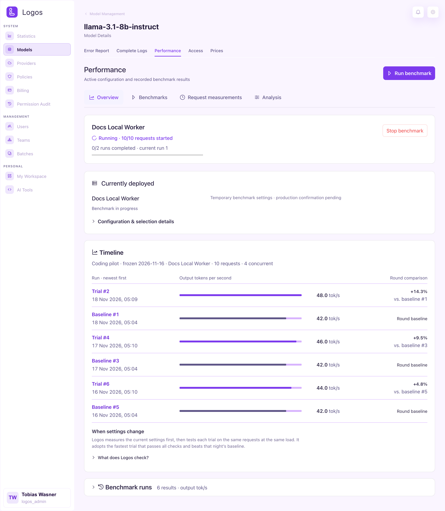

**Stopped · benchmark window ended** means fewer than half of the test's requests completed successfully before the scheduled end.
The status card shows how many requests completed when that count is available.
The unfinished test does not produce a completed measurement. Earlier completed measurements remain in **Benchmark runs**.
Expand **View stop details & configuration** to read the technical reason.
This stop alone does not confirm that the worker is ready. Actual worker errors remain errors.

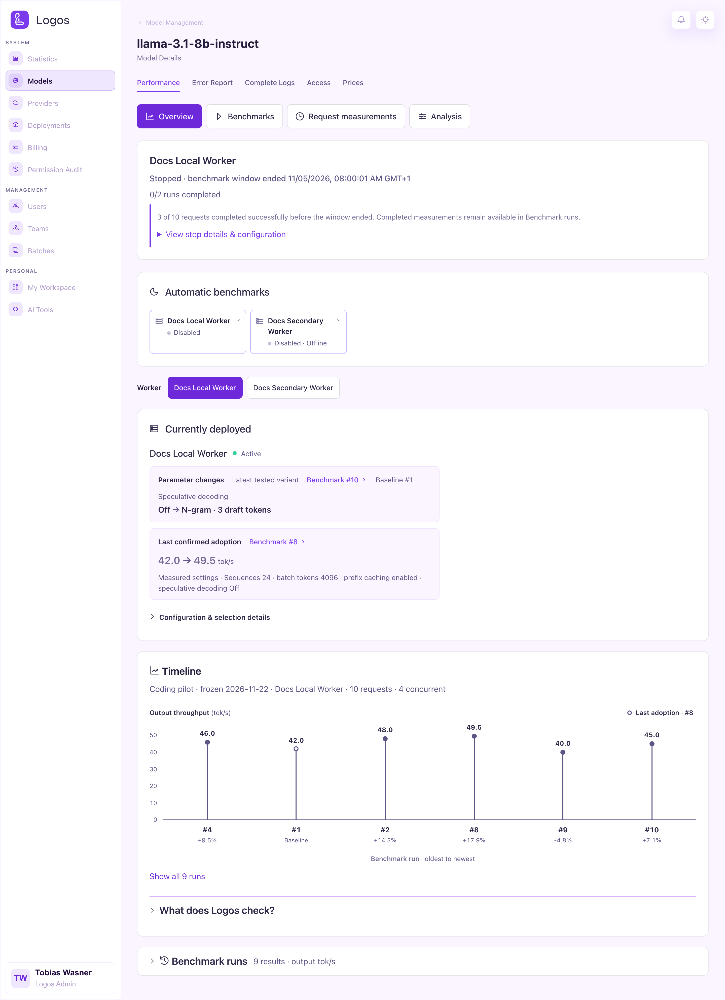

The [Model Benchmarks guide](../admin/model-benchmarks.md) explains the confirmation dialog, single-run charts, batches and failed-model retries.

The **Performance → Overview** section shows **Automatic benchmarks**, **Currently deployed** and **Timeline**.
Select **Benchmarks** for manual runs, **Request measurements** for request times, or **Analysis** for comparisons.
Expand **Benchmark runs** to read saved runs grouped by dataset.
Without a nightly series, expand **Benchmark runs** to find **Highest recorded throughput** for each provider's latest captured workload.
Older workloads are not ranked against it. Unknown controls do not establish a comparison.
Manual benchmarks do not apply these parameters automatically. Nightly runs with saved request datasets can apply verified improvements.

Select **Benchmarks** for the manual run setup. The page shows the provider, sample size and current test setup.
Select **Customize** to change advanced controls. Select **Done** to keep the settings and return to the start button.

To benchmark saved requests manually, open **Benchmarks → Customize**.
Select the saved dataset under **Input dataset**. Logos fixes the sample size to its request count.
The run preserves each source request's output limit. Set the profile and concurrency for the comparison.
**Repeat or compare settings** uses the same saved requests for every configuration.

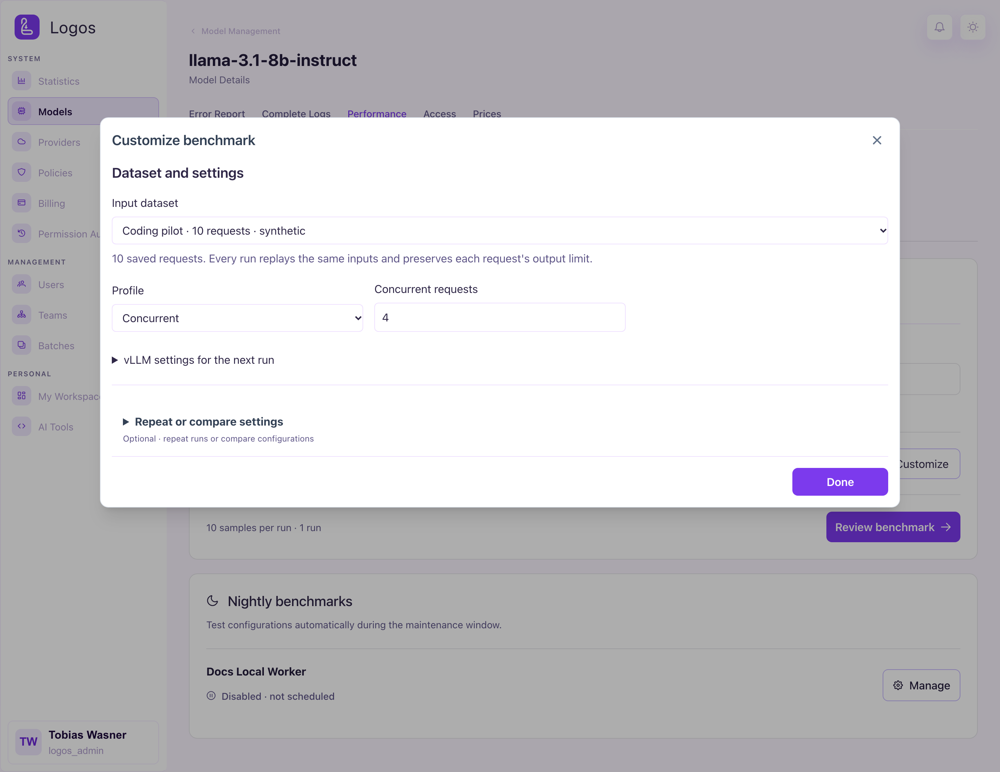

Select **Customize**, open **Repeat or compare settings**, and select **Run a batch** to compare parameter values.
Open **View run plan & fixed settings** to check each combination and the saved request count.
The frozen dataset keeps its source inference and output settings for all runs.
A response that reaches the caller's explicit token limit completes the requested output budget.
A missing stream terminator or an earlier context limit makes the run fail.

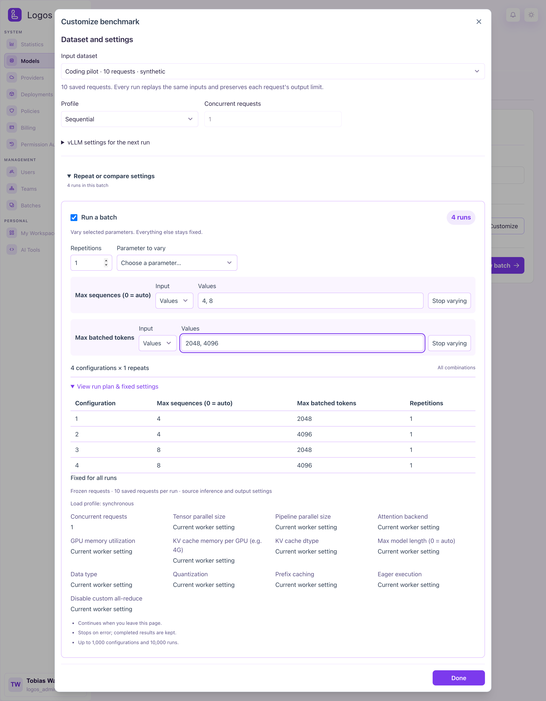

If the model has more than one worker, then use **Worker** above **Currently deployed** to select one.
This selection changes **Currently deployed** and **Timeline** together.
Logos gives priority to an online worker with saved measurements.
The **Timeline** shows up to 6 complete runs for the selected worker and workload.
It includes the current deployment when a matching measurement is available.
Read the runs from left to right in completion order.
Each dot shows output tokens per second (tok/s) on the vertical scale. An open circle marks a baseline.
A blue ring marks the benchmark for the active configuration. Select **Deployed** to find it in a long timeline.
Select **Last adoption** when available to find the last confirmed adoption if the live settings cannot be matched.
Each trial shows its change from the baseline of its round, if available.
Select a run to open the benchmark dialog with its settings and any reason for exclusion.
Select **Show all** to see older runs.
Expand **What does Logos check?** for the nightly adoption checks and examples of the request latency limit.
Expand **Benchmark runs** to see the latest 5 results per dataset.
A baseline shows its own throughput and 0% change. Missing comparisons show why the baseline is unavailable. Select **Show all** to read older results.
Select **Before**, **After** or **Change** to sort all results from highest to lowest.
Select the same column again to reverse the order. Missing values stay at the end.

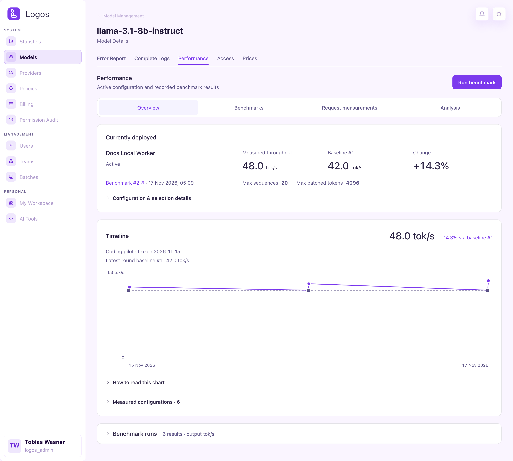

Read **Currently deployed** below **Automatic benchmarks** in **Performance → Overview**.
**Parameter changes** shows the values that differ from the round baseline for the active or latest saved trial.
If no trial changes are available, then the summary shows the live batching limits and any reported prefix caching and speculative decoding settings.
Expand **Configuration & selection details** for **Run selection**.
Expand **Serving settings** to see the full worker configuration.
The view identifies measurements with matching settings and the same measurement environment.
Measurements from another environment appear with a historical label. They do not verify current performance.
If a batching limit is unavailable, it shows **Not reported**.
If no benchmark matches, then **Last confirmed adoption** can show the last adopted result and link to its benchmark.
If a limit is unavailable and there is no saved adoption, then the summary shows **Live benchmark unverified**.
The measurement includes its benchmark number, baseline throughput, result throughput and percentage change.
Temporary benchmark settings and recovery states do not establish the production configuration.
The status distinguishes an offline worker, a sleeping model and a model waiting to start. A sleeping model can still show its configured settings. Active replicas with different settings are identified separately.
Manual measurements can show their change from the first comparable dataset baseline. The summary labels this baseline as **Starting baseline**.
**Run selection** shows the fastest measured run, the fastest run that passed the checks and the last confirmed adoption when those results are available.
Expand **Why other runs were excluded** to read the reasons by run. When per-request counts were recorded, **Answer length changes** shows the baseline and trial token counts and the percentage change for each answer outside the allowed range.
A fresh comparison must verify a historical candidate before automatic adoption.

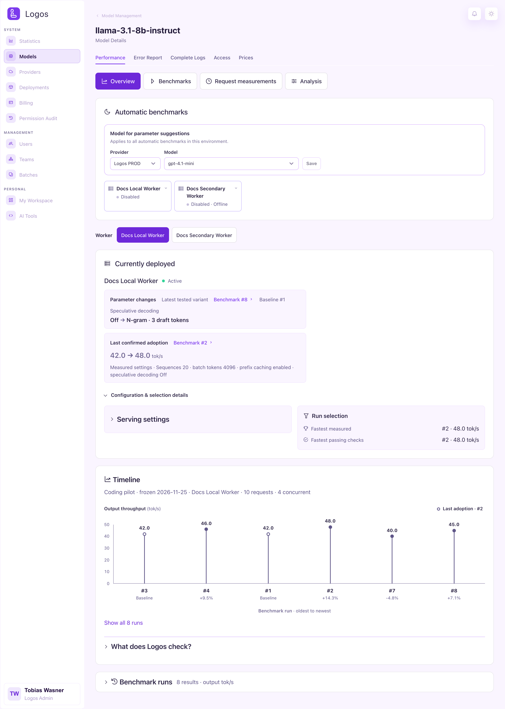

Configuration details and benchmark history start closed on desktop and mobile.
**Analysis** opens with **Compare parameter values** expanded. Select the **Reference run**, **Parameter** and **Metric**.
The chart shows one parameter at a time, with a dashed reference line and measured changes. Select **Prefix caching** or **N-gram decoding** when those settings have comparable results.
Only matching workloads and other captured settings enter the comparison.
A single parameter value shows an explanation instead of an empty comparison chart.

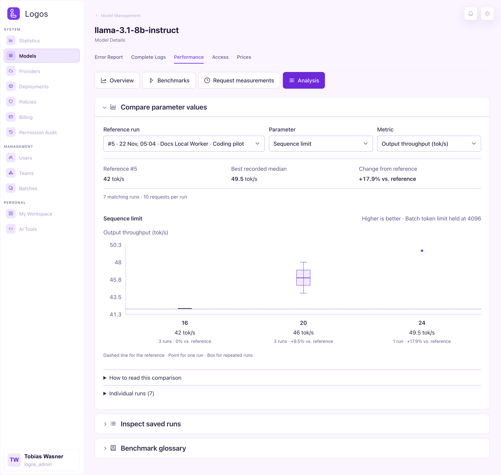

Expand **Inspect saved runs** to inspect a selected run.
Expand **Configuration** for its captured benchmark settings and serving parameters.
Expand **Fields not captured** to see unavailable fields.

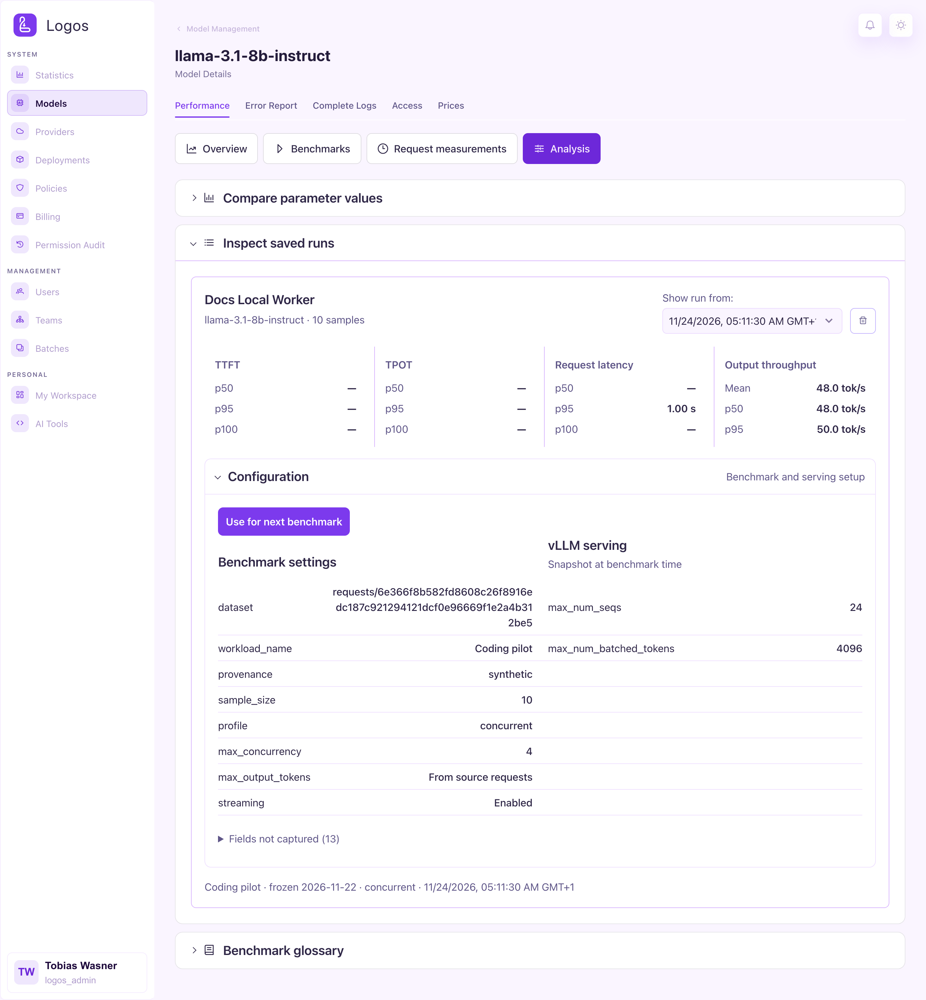

Expand **Benchmark glossary** for metric definitions and nightly parameter names.
Expand **Runtime terms and other serving parameters** for less common terms.

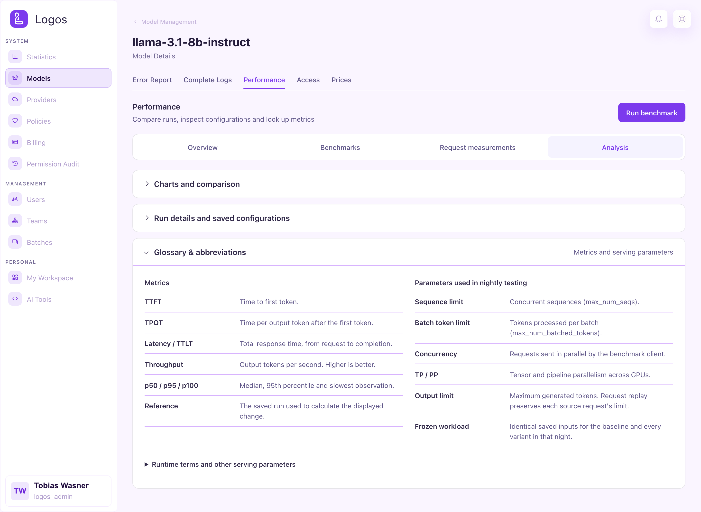

### Nightly Benchmarks

The **Performance** tab provides nightly benchmarks for each model/worker pair.
Calibration runs first. Benchmarks use the remaining time.
The configured maintenance limit controls simultaneous workers, including manual starts. The default is 1 worker.
Schedules are off by default. Activation requires an updated, connected worker.
See [deployment requirements](../deployment.md#nightly-benchmarks) before activation.
See the [nightly benchmark guide](../admin/nightly-benchmarks.md) for rotation, parameter values and recovery rules.

1. Open a model from **Models**.
2. Select **Performance**.
3. Under **Automatic benchmarks**, select the tile for the worker.
4. Check the time window and **Request workload**. Apply any dataset change.
5. Select **Enable automatic benchmarks**. If the button is unavailable, then read the message.

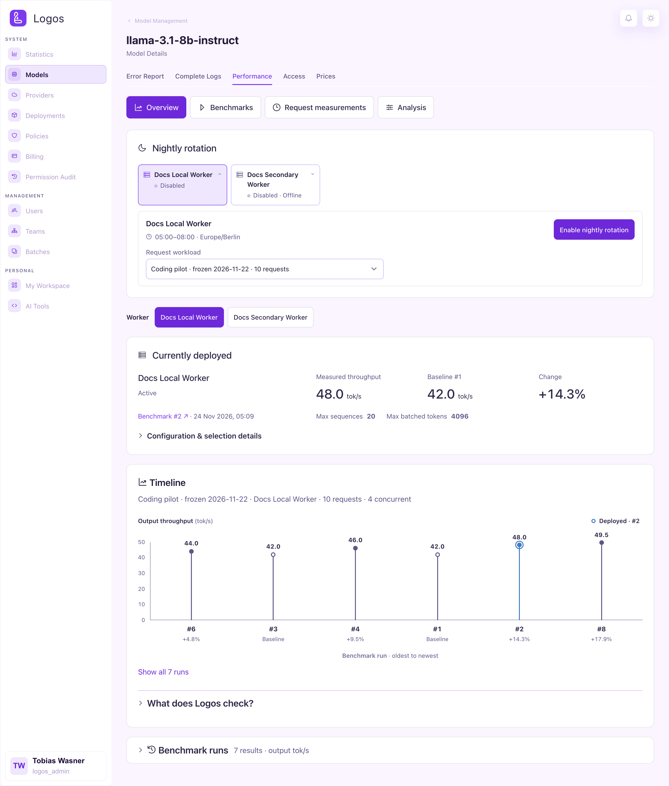

The worker tile then shows **Enabled** with a green dot.
The tile shows **Offline** if Logos cannot connect to the worker.
The schedule stays active after a page reload.
Each night, Logos selects up to `LOGOS_NIGHTLY_MAX_PAIRS` eligible pairs, with new or older attempts first.

Use **Request workload** to select a saved dataset for the nightly schedule.
Choose **Recent FULL request logs**, keep **Latest 100 requests** and click **Create and apply dataset**. On production, this saves up to 100 replayable requests for the model from the production log. You can also select a time window. Each dataset has a 5 MB limit.
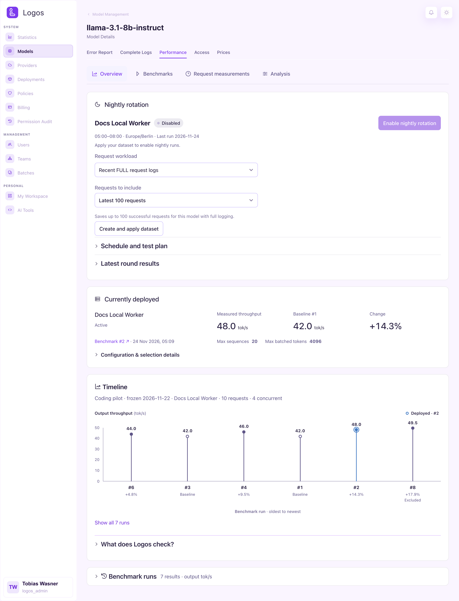

The dataset keeps its inputs when source logs are deleted.
The first successful run establishes a new reference for this dataset.
Each night measures production settings and searches around the previous winner.
Eligible improvements over the current baseline apply automatically after the worker confirms its configuration and model readiness.
Otherwise, production settings return after each round. The pairs take turns until the window ends.
The dataset keeps its original freeze date across runs. Its content hash remains in the configuration details.
Logos sends one notification after the last round of each scheduled run.
The notification shows the result and the last interruption reason, if available.
Select **View benchmark** with its number to open the benchmark dialog.
The **Benchmark runs** table groups runs by dataset. Select a column heading to change the order.
Each sortable column cycles through the initial order, ascending order and descending order.

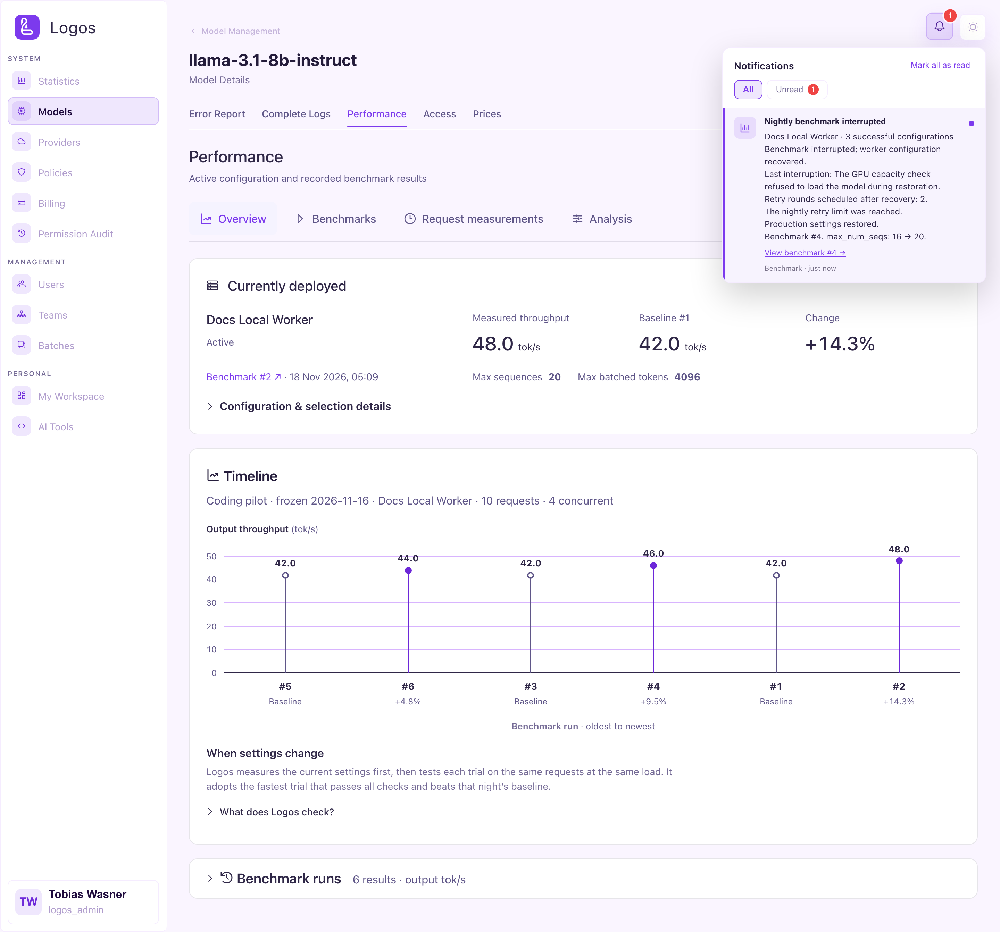

A direct link opens the same dialog. It shows the selected benchmark when new results arrive.
If the measurement is deleted, then the dialog shows that the benchmark is unavailable.
Close the dialog to return to the same worker and timeline position.

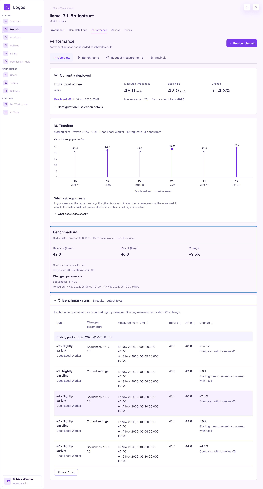

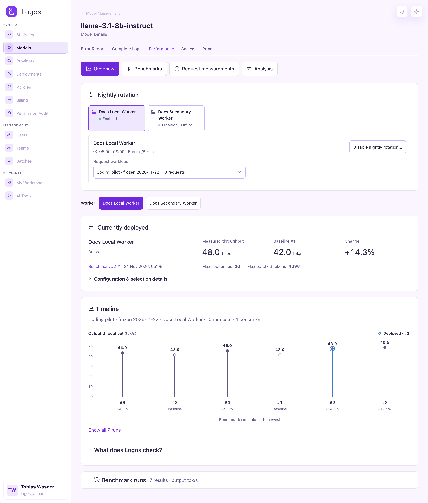

Select the worker tile to see the workload and maintenance window.
Select **Edit schedule** to set the daily start and end time for this model and worker.
The default is 05:00–08:00 in Europe/Berlin. Select **Save window** to apply the change to future rounds.

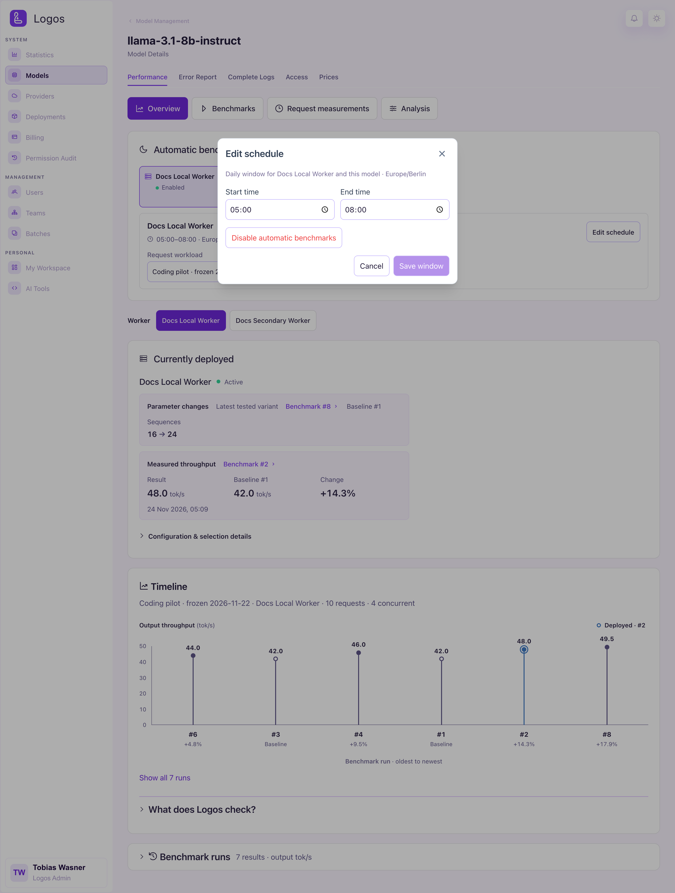

Logos checks GPU memory for the benchmark lane and its warm-up before the round.
If the worker needs more GPU memory, then the schedule shows **Waiting for GPU capacity**.
Other models on the same worker continue to serve requests.

Some deployments select a user instead of a fixed dataset.
**Request workload** shows the configured number of successful FULL requests and the username.
All configurations use the same selection for that night.
The dataset controls are unavailable because the deployment setting controls this source.
The worker shows a selection error if too few requests qualify.
See [deployment-specific request sources](../admin/nightly-benchmarks.md#deployment-specific-request-sources) for the exact rules.

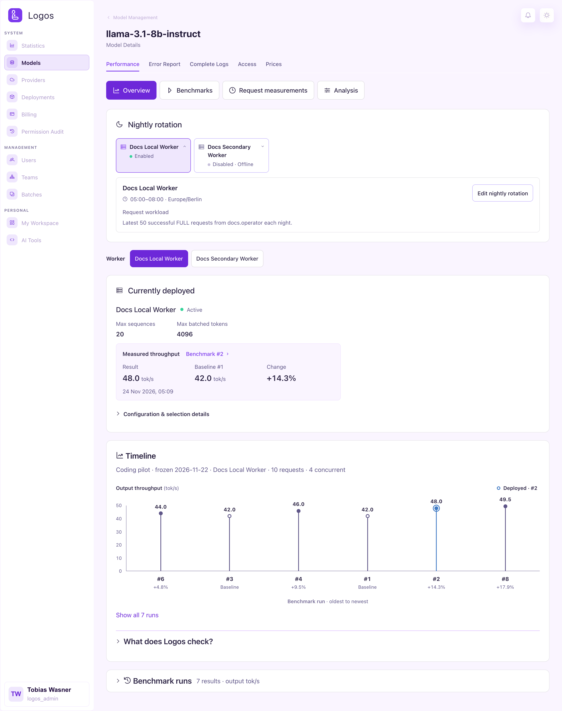

To remove the pair from the nightly rotation:

1. Under **Automatic benchmarks**, select the tile for the worker.
2. Select **Edit schedule**, then **Disable automatic benchmarks**.
3. Read the dialog and select **Disable automatic benchmarks**.
4. Check for **Disabled** and a gray dot on the worker tile.

Select **Cancel** to keep the schedule active.
Deactivation stops an active benchmark and restores the worker configuration before production resumes.

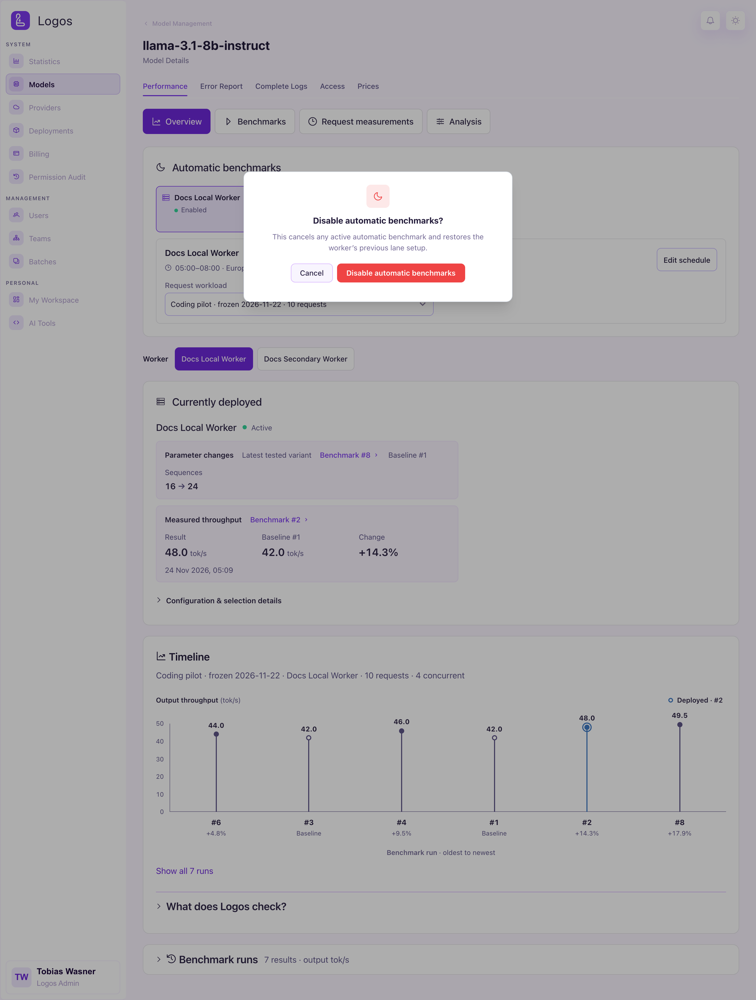

## Providers

This page shows each provider that the deployment knows, in two lists.
**Cloud Providers** lists the cloud providers (Azure, OpenAI, Anthropic and
others) with their vendor. **Local Providers** lists the connected worker
nodes. For each provider, the page shows the privacy level and the base URL.
Expand a provider for its connected models, or for the worker control actions
(calibrate, sleep, wake, lane management).

### Set a monthly cloud spend cap

1. Expand a cloud provider in **Providers**.
2. In **Monthly spend cap**, select **Edit spend cap**.
3. Select **Enable cap** and enter the **Monthly maximum (USD)**.
4. Select **Save changes**.

To remove the cap, clear **Enable cap** and select **Save changes**.
Changes are saved for the current UTC month and continue each month unless a scheduled change replaces them.
A limit of $0 blocks new billable requests through Logos.

The section shows the current limit, the next scheduled change, and recorded charges for this month.
Logos adds positive, finalized costs from the provider's request logs in the current UTC billing month.
This total includes recorded costs from periods without a cap when you enable or re-enable it.
Logos does not count unpriced requests or spend outside Logos. For example, provider-native batches or
benchmarks without a finalized request cost do not add to the total. This total is not the vendor invoice.

When recorded charges reach the limit, Logos blocks new requests.
Admission checks can take up to 5 seconds to pick up a limit change, newly recorded charges, or the UTC month rollover.
Requests already in progress can finish. The final total can exceed the limit.

The administrator API also accepts GET and PUT at `/logosdb/providers/{providerId}/monthly-spend-cap`.
Use the provider record ID, not the vendor account ID.
To set the current limit, send `{"enabled": true, "limit_usd": "400"}`.
To remove the current limit, send `{"enabled": false}`.
To schedule a separate change for the next UTC month, send the same payload to
`PUT /logosdb/providers/{providerId}/monthly-spend-cap/scheduled`.

### Add a Provider

Select **Add Provider**. The dialog asks for the classification first:

1. Select the **Provider Type**: `cloud` for a vendor API, `logosnode` for a
   worker node.
2. For a cloud provider, select the **Cloud Provider** (the vendor). The vendor
   decides how Logos authenticates and which protocol headers it sends, and
   the model sync discovers the models only with the correct vendor. Select
   **other (OpenAI-compatible)** for an endpoint of no listed vendor.
3. Select the **Privacy Level**: where the provider processes the data, for
   example **Cloud in the EU, US provider**.
4. Check the **Base URL**. For OpenAI, Anthropic, DeepSeek and Groq, the dialog
   proposes the public endpoint of the vendor. Replace it for a proxy or a
   regional endpoint. A URL that you typed stays when you change the vendor.
5. Enter the **Name**. For a cloud provider, enter its **API Key**. Leave **Header Name** and **Format**
   empty to use the vendor default that the placeholders show.

Open **Edit Provider** to see the masked key. The key can show up to its last 3 characters.
For an existing cloud provider, open **Providers → Edit Provider**. Verify the processing commitment for its actual base URL, every connected deployment and any fallback with the provider. Select the applicable EU privacy level, set the regional **Base URL**, check **I verified EU processing for all deployments on this endpoint, including routing and fallback**, then save. Editing the base URL clears the confirmation. An unconfirmed provider remains unavailable to EU-scoped teams. Configure separate providers for endpoints with different regional guarantees. Provider-native batch has a separate processing path and is available to worldwide teams. EU-scoped teams can use the Logos-managed batch path.

To replace the key, select **Rotate**. Enter the key from the cloud provider in **New API key**.
Select **Rotate** to apply it, or **Cancel** to keep the current key.
Use the same steps in **Edit Connection** for a key specific to one model.

Select **Remove** to remove a stored key. Confirm with **Remove**.
After you remove a connection key, the connection uses the provider key, if available.
After you remove a provider key, connections without their own key send requests without an API key.

Expand a provider to see its connected models. Next to the endpoint, each model
shows whether its batches can use the provider's Batch API: **Batch**, **No
batch**, **Batch unchecked**, or **Batch in Logos** for worker nodes. The tooltip
names the batch deployment or the reason for a refusal. See
[Batch status of a model](../batch-processing.md#batch-status-of-a-model).

### Provision a worker key

1. Open **Edit Provider** for the worker node.
2. Select **Rotate** next to the masked key.
3. Confirm with **Rotate**. The previous key immediately stops working for new authentication requests.

4. Select **Copy** in **Worker key rotated** before you close the dialog.
5. Set the deployment secret `LOGOS_API_KEY` for this worker to the new value.
6. Recreate the worker with the updated environment. Recreate its node manager if the worker uses one.
7. Check that the worker connects to Logos.

If you lose the new value, rotate the key again.
The management export omits provider and model connection keys. Provision them again after you restore an export.

### Node models

Expand a worker node to see the **Node models** list. The list shows each model
that the worker can serve. Cloud providers keep the **Connected Models** list.

Each row shows two statuses:

- **Calibration**: **Calibrated**, **Not calibrated**, **Outdated** or **Unsupported**.
  Logos measures the memory use of a model during a calibration.
- **Placement**: **Set** if the model has a placement (GPUs, KV cache and
  context length). The row then shows these values. If the model has a calibration but no
  placement, the status is **Automatic**, and the worker chooses the placement itself.
  If the model has no calibration, the status is **Not loadable**. The worker loads a model only
  with a calibration.

The chip at the top shows **Worker online** or **Worker offline**. Select a row
to open the page of the model.

### Model page

The model page shows the configuration of one model on one worker node.

The page has these parts:

- **Configuration**: the tile of the tensor parallel size (TP), the KV cache memory for each GPU
  and the maximum context length. Each slider shows the measured range. A grey band marks what the
  calibration measured. Hatching marks what it did not measure.
- **Figures**: the GPU memory in use, the context capacity, the load times and, if a benchmark ran
  this placement, its throughput and latencies.
- **Advanced settings**: the settings of the model that are not part of the placement.
  Select **N set** to open or close the list.
- **Best benchmark**: the best result of the nightly benchmarks for this model.
  Select **Open all benchmarks** to see them all. The part is not shown if the model has no benchmark.

If a comparable benchmark found better values, then the page shows the purple banner
**Recommendation not in use**. It names the placement, the number of parallel requests and the batch size,
and how much faster the run was. The page compares the run with the stored configuration of the model.
The nightly benchmark changes only the running lane and never the stored configuration.
Select **Edit configuration** and then **Use recommendation** to store the values.
The button sets the placement and **Max. parallel requests**.
It also writes `--max-num-seqs` and `--max-num-batched-tokens` as the last lines of **Extra arguments**.
A flag in **Extra arguments** decides over the field and over the global arguments of the node.
A change of these batch values makes the calibration outdated.
If the worker is offline, the page shows a banner and you cannot edit the model.

### Edit the configuration of a model

You can edit a model that has a calibration. The worker must be online.

1. Open the model page.
2. Select **Edit configuration**. For a model without a placement, select **Set placement**.
3. Select the number of GPUs. Only sizes that the calibration measured are available.
4. Set the KV cache memory. Use whole GB inside the measured range.
5. Set the maximum context length. The limit follows the chosen KV cache size.
6. Change the fields in **Advanced settings** if necessary.
7. Select **Save**.

The **Current configuration** card shows the stored values. It changes only after you save.
A choice of the size, the KV cache memory or the context length does not make the calibration
outdated if the calibration measured it. A choice that the calibration did not measure makes it outdated.
The figures below the sliders follow your changes.

If a comparable benchmark found a better placement, then the purple banner
**Recommended by benchmark** shows it. Select **Use recommendation** to set the size, the
KV cache memory and the context length. You can change them afterwards.

**Advanced settings** has groups: **Placement**, **Engine** and, under **All engine settings**,
**Memory and precision**, **Performance and stability**, **Serving** and **Arguments**.
In **Memory and precision**, the field **Base residency** replaces the memory that the calibration
measured for the weights. Use it only if the calibration cannot measure the model.
A new value marks the calibration as outdated.
Type in **Filter settings** to find a setting by name or key. A dot marks a setting that has a value.
Select **Use default** to remove the value of a setting. In **GPU devices**, select the GPUs that
the model may use. If all GPUs are selected, then the model may use all of them.

The save bar lists your changes. The worker checks all settings before Logos stores them.
This takes a few seconds. The worker uses the new settings when it starts the lane the next time.

If a value is not valid, then Logos shows the message at the field. Nothing is saved.
If another admin saved the node at the same time, then Logos shows **Configuration changed**.
Select **Reload** to load the new state. Your changes are lost.

A change of the KV cache size or the context length inside the measured range does
not start a new calibration. A change of a setting that the calibration depends on
does start one. Examples are the tensor parallel size, the quantization and the
extra arguments.

Use **Custom settings** for a vLLM setting that has no field. The worker rejects a name that it
does not know. If the name looks like a known one, then Logos suggests the correct name.

### Calibrate a model

A model without a calibration has no placement. The page shows its running settings and calibration settings.

Select **Edit settings** to adjust the engine settings before calibration.
Select **Save** to apply your changes.

1. Open the model page.
2. Select **Calibrate model**.
3. Wait. The calibration takes several minutes.

The button shows **Calibrating…** while the worker measures the model.
Before it starts, the page asks you to confirm. The page shows the result when the calibration is done.
You can calibrate a model if its calibration is outdated in the same way.
Select **Stop calibration** and confirm to end the calibration of the node. The model in progress stays uncalibrated.

If the page shows **Calibration not supported**, the worker cannot load the model.
Select **Open the error report** to see the **Error report** for that model.

### Connect a model

1. Expand the worker node.
2. Select **Connect model**.
3. Select a model of the Logos catalog.
4. Select **Connect**.

The model is in the list as **Not calibrated** with the placement **Not loadable**.
The dialog shows only models that the node does not list yet.

### Node settings

The settings of the whole node are on one page. Select **Node settings** in the
expanded worker node.

| Card | Setting | Meaning |
|---|---|---|
| **GPU pool** | `gpu_devices` | The GPUs on which the node can place lanes: all, none or selected GPUs. |
| **Engine defaults** | `global_extra_args` | The vLLM arguments that Logos adds to every lane. One argument in each line. |
| **Node care** | `auto_reboot_on_stuck_gpu` | Restarts the host if all lanes failed and a GPU holds unused memory. The worker uses a new value after the next start. |
| **Node care** | `gpu_poll_interval` | The time in seconds between two readings of the GPU memory (1 to 300). |

An empty field keeps the value of the `config.yml` file of the worker.
If you change the global arguments, then every model of the node is measured again
in the next calibration window. The worker uses a new GPU poll interval after the next start.
You can save the settings if the worker is offline. The worker applies them when it connects.

## Deployments

The page **Deployments** deploys Logos from Logos. It is for Logos admins only. A
deployer on each host takes the orders. A Logos deploys only itself: use the page
of Prod to deploy Prod, the page of Dev to deploy Dev, and the page of Test to
deploy Test. See [Deployments from Logos](../deployment.md#deployments-from-logos)
to install the deployers.

If no deployer is set up, the page says so, and the button **Deploy** is off.

The page has these parts:

* **Current deployment.** The deployment that runs now, with one row for each
  node. Each row shows how far the node is: Pull, Drain, Swap and Verify. A node
  is *Waiting for the core*, *Waiting for the deployer*, *Running*,
  *Succeeded*, *Unchanged*, *Rolled back*, *Failed* or *Not started*. Click
  **View details** to open the page of the deployment. Click **Abandon deployment**
  to stop the next steps of a deployment that this Logos started. Without a
  running deployment, the part shows the last one.
* **New deployment.** Enter an image tag and click **Deploy**.
  Prod shows a red banner. When you click **Deploy** on Prod, a dialog asks you
  to confirm: click **Deploy** in the dialog to start, or **Cancel** to not
  start. Dev and Test start at once. The button is off, with a reason, when the
  core deployer is not online or a deployment runs.
* **History.** The latest 50 deployments, each with its number, the person who
  started it and the time. Filter them by status. Click a row to open its page.
* **Page of a deployment.** Click a row of the history, or **View details**, to open
  it. The page shows the status, the events of each node and, for a
  failed part, the end of the container log. A running deployment updates itself.
* **Deployers.** The deployers of this Logos, when each was seen, and its
  version. A worker appears in this list when its node manager asks Logos for
  orders for the first time. It uses its worker key. Click **Add a core
  deployer** to make the core deployer. Logos shows its key once.

### Start a deployment

1. Enter an image tag in **Image tag**. The list suggests `latest` and the tags
   of the last deployments.
2. Click **Deploy**.
3. On a protected Logos, a dialog asks you to confirm. Click **Deploy** in the
   dialog to start. Click **Cancel** to not start.
4. Logos opens the page of the new deployment.

A protected Logos shows the red banner **Deployments on this Logos affect live
users**. It accepts only `latest` and release versions such as `1.0.2`. Prod is
protected. Dev and Test are not, so they start at once.

### Follow a deployment

The core goes first. If the core succeeded, all GPU workers start. The
orchestrator keeps only one worker out of service at a time. The bar of a node
has four parts: **Pull**, **Drain**, **Swap** and **Verify**. The bar shows how
far the node is.

In the figure, the core succeeded. The worker waits in the part **Drain** until
the requests of its node end. The page updates itself.

Click **Abandon deployment** to stop the steps that did not start. A host that
got its order finishes it. A node that runs the new image keeps it.

### Read the result

Click a row of the history, or **View details**, to open the page of a
deployment. The page shows the events of each node in the order that they
happened.

If the node takes its compose file from the image of the tag, the first event
names the file. The next events show the pull, the drain, the swap and the
check. For a worker, the events also show how long the node waited for its
requests.

If the new container of a worker does not come up, the node manager starts the
previous version again. The node then has the status **Rolled back**. The page
shows the reason and the end of the container log of the new container.

If the core fails, the workers do not start. They have the status **Not
started**. A core deployment has no automatic rollback. Fix the cause and deploy
again.

### Add a core deployer

1. In the part **Deployers**, click **Add a core deployer**.
2. Enter the name of the core host.
3. Click **Make the deployer**.
4. Copy the key. Logos shows the key one time.
5. Click **I have copied the key**.

Store the key as the secret `LOGOS_DEPLOYER_KEY` of the core host. If you lose a
key, click **New key** for the deployer. The old key stops at once. A worker
needs no key. It appears in the list when its node manager asks Logos for
orders.

## Billing

This page shows the costs for each team, model and provider. Logos calculates
the costs from the usage logs and from the configured catalogue prices.

## Users

Use the role selector in **Users** to promote or demote an account, including accounts that sign in with Keycloak. The next management request uses the saved Logos role. To demote a team owner to App Developer, assign another eligible owner and remove the original ownership first. Keycloak continues to supply identity details and account availability.

## Teams

The team list shows each team’s privacy setting, owners and members.

Select the **View permission history** action beside a team to open its permission audit log.
The log starts with that team's ID as a filter.

### Team privacy

In **New Team**, enter a name and choose where requests can be processed. Each team must have a privacy setting.
Type part of a name or username in **Search owners**. Select each owner. Your selections stay when you change the search.

| Team privacy | Eligible deployments |
| --- | --- |
| Local models only | Logos workers classified as local |
| Local models and cloud processing in the EU | Local workers and cloud endpoints with verified EU processing |
| Local models and cloud processing worldwide | Local and international providers, subject to the key’s grants and the request’s privacy profile |

Change the setting under **Teams → Settings → Team privacy**. It applies to every key, including custom permissions and keys issued before the change. A model served at multiple providers stays available through its eligible deployments. Historical EU labels need the same endpoint confirmation when a request selects a geographically restricted profile. Existing optional routing profiles continue to restrict requests that select them, including profiles requiring an EU-based provider. Use **Team Management** for queue priority and the team’s **Settings** for budgets and limits. Operators manage optional profiles through the management API (`POST /logosdb/get_policies`, `/logosdb/add_policy`, `/logosdb/update_policy` and `/logosdb/delete_policy`). A client selects a stored profile with the `policy` header. Within the team’s privacy limit, the profile can set thresholds for latency, accuracy, cost and quality, plus priority and topic.

Logos keeps grants that the current privacy setting hides. Saving the visible permissions leaves those hidden grants in place. They become available again when the team and provider settings permit them.

When you open a team, you see the same detail tabs as an owning App Admin sees.
For the tabs Overview to Settings, see [App Admin → Teams](app-admin.md#teams).
Logos Admins also get a **Providers** tab. This tab shows which cloud
providers and worker providers the team can use.

For an assigned Azure provider, select **Auto-allow synced Azure models** to give default team keys access to its synced deployments.
The option is off by default. It applies only to this team and provider.
The team privacy setting still applies. The option does not change custom key permissions.
Clear the option to remove automatic access. Manually granted models keep their access.

## Permission Audit

Only Logos Admins can open **Permission Audit** in the sidebar.
The page shows model and provider permission changes for teams and API keys.
Each entry shows the action, time, recorded names, IDs, actor and cause.

1. Open **Permission Audit** to see changes across all teams.
2. Enter a team, API key, model or provider ID to limit the results.
3. Enter a local time range if necessary.
4. Select **Apply filters**.
5. Select **Older** or **Newer** to move through the results.

Select a name in the results to filter by its ID.
Select **Clear filters** to see all changes again.
The end of a time range excludes changes at that time.
The URL keeps the filters when you share or bookmark the page.

If you delete a team or API key, its history remains available from **Permission Audit**.
The entries keep the names and IDs from the time of each change.
Deletion also records the removal of its permission grants.
History starts when permission auditing is enabled.
The page does not change permissions.

## Agent Sessions

This page shows the coding-agent sessions of the
[agent runner](https://github.com/LogosOSS/Logos/blob/main/logos-agent/README.md).
For each session, it shows the work, the state and the pull request. Every
Logos Admin can open the page. The **Agents** entry in the sidebar shows only
if the deployment runs the optional agent stack.

The page has these parts, from top to bottom:

- **Status tiles.** **Runner** shows the mode of the runner. **Sessions** shows
  the running sessions and the limit, and the sessions that wait. **Memory**
  shows the memory that the sessions reserve and the memory budget of the
  host. **Platform capacity** shows if a new session can start, and the reason.
- **Runner controls.** In **Mode**, select **Run**, **Stop new sessions** or
  **Pause everything**. **Stop new sessions** lets the running sessions
  finish. **Pause everything** pauses the running sessions and gives the
  capacity back to the platform. **Reason** is an optional note for the
  change.
- **Memory per session (MiB)** sets the memory limit of each new session. A
  running session keeps its memory limit.
- **Sessions at once** sets the maximum number of sessions that run at the
  same time. The maximum is the number of sessions that the memory budget
  holds. You can only set a lower value. The value 0 starts no new session.
- **Model inference** sets where new sessions send model requests. Only Logos Admins can change this setting.
- **Session lists.** **Active**, **Queue** and **Finished** show the
  sessions. Select a session to show its details and messages. Use the
  arrows of a queued session to change its position in the queue.
  **RAM now** shows the latest total for the session containers, including helpers and file cache.
  The runner samples about every 2 seconds. A short peak between samples can be higher.
  **Observed peak** keeps the highest sample after the session ends or the runner restarts.
  **Unavailable** means there is no measurement. **Limit** shows the limit per container at the start of the session.
  A **2x** badge means the parent used one distinct Claude Code subagent. A second child makes it **3x**.
  The count includes children that already finished. Older sessions without recorded identities have no badge.
  **Agent estimate** shows the parent’s latest self-reported percentage and when it reported.
  After about ten active minutes, the next completed tool call reminds the parent to estimate again.
  Long tool calls can delay a report. At 40% after 20 active minutes, the forecast is about 30 more active minutes.
  Pausing freezes the countdown. An elapsed forecast or 20 active minutes without a new report displays
  **Awaiting updated estimate**. Session status records the actual outcome.
- **Automatic work**, **Workspaces** and **What every session is told** are
  at the bottom of the page. **Workspaces** shows the disk use of each checkout and its cache.
  **Runner artifact disk** shows the capacity and free space of the filesystem that stores agent artifacts.
  Docker volumes can use a different filesystem. This view does not set disk limits.

Select a session to read **Agent messages** as the agent works. **Agent** identifies
the parent. **Subagent** and a short identifier distinguish child messages.
Short messages are visible inline. Select a long message preview to expand
its paragraphs, lists and code. Open **Diagnostic log** to see tool activity
and runner output, including the logs of older sessions.
The message view keeps up to 64 recent messages and marks shortened text.

Repository analyses of the linked repositories of the teams also run here.
Each night, they run again for repositories that have new commits. **Analyze
enabled repositories** in **Automatic work** immediately queues an analysis for
every repository with **Automatic workflow analysis** enabled, even if there are no new commits. Use it, for
example, after an improvement of the analysis. It does not change repositories
that already have an analysis that is queued or that runs. The results go to
the teams as proposals on their **Workflows** tab
([Team detail](app-admin.md#workflows)).

### Choose a model for new sessions

1. Open **Agents** and go to **Runner controls**.
2. In **Model inference**, select **Local** or **Cloud**.
3. In **Inference model**, select the model.
4. Select **Save inference settings**.

For **Local**, select a model served by Logos. The selector does not pin a worker.
Select **Runner default (per-session model)** to keep the model picker in **New session**.
If you set a model in **Runner controls**, the new session shows this model instead of a picker.

For **Cloud**, choose an allowed provider and model pair. The target must be an approved Logos provider that supports the Messages API.
This selection pins the exact provider and model and does not use a local worker.
If the environment has no allowed target, you cannot save a cloud selection.
The selector never displays or accepts a provider URL, API key, or other secret.
Use a destination key limited to the intended models and confirm that the repository data may be sent to that gateway.
A linked repository's team privacy setting still applies and can block the selected cloud provider.
The destination Logos environment meters calls against that key.

Changes apply to new sessions only. A session keeps the environment where it starts, such as Dev or Test.
Selecting cloud inference does not move the session or its work to another Logos environment.

### Start a Session

To queue a manual session, do these steps:

1. Select **New session**. The **Start a session** form opens.
2. In **Repository**, select the repository that the agent changes:
   - **LogosOSS/Logos (platform repository)** is the default.
   - Each linked team repository with the coding agent enabled shows as
     `owner/name (branch)`.
3. In **Workspace**, select a workspace. One workspace runs one session at a time.
4. In **Task**, write the change that you want.
5. Optionally set **RAM limit (MiB)** for this session. Leave it blank to use
   the runner default. A custom request waits for enough memory to be free;
   it does not change the default for other sessions.
6. To keep the result in Logos, select **Private session: no GitHub writes**.
7. Select **Queue session**.

The example shows the linked repository `docs-example/sample-app` with the
branch `develop`. For a linked repository, the session works on that
repository and its branch. The form disables **Screenshot paths** for linked
repositories. A platform session can capture pages on the Dev instance that
already runs. These screenshots do not deploy session changes. An operator
[deploys changes separately](../deployment.md#deploy-from-github).

In a private session, the agent can read issues from the linked repository.
It cannot create a fork, push a branch, post a comment, or open a pull request.
It cannot capture Dev screenshots.
In **Task**, ask for the issue link, the proposed change, and the checks in the final response.
Expand the session and open **Agent messages** to review the result.

The session list and the session details show the repository of a session on
a linked repository. In the session list, the repository shows below the task,
next to the workspace. For example, see `docs-example/sample-app` in the
**Finished** section of the **Agent Sessions** page image.

A Logos Admin also sets the network access and the comment permission of each
linked repository. Edit the repository link on the **Repositories** tab of the
team ([Agent Sandbox Permissions](app-admin.md#agent-sandbox-permissions)).

## My Workspace

This page is the developer view of the signed-in user. It shows the teams of
the user and the API keys of the user. You can create, rotate and revoke keys.
You can also set model permissions for each key. Every role that has at least
one team and one key can use this page.

## AI Tools

This is the same guided setup as for every other role. Select a coding
assistant, a team key and a model. Then install the assistant and connect it.
The page does not change with the role. For the step-by-step procedure, see
[App Developer → AI Tools](app-developer.md#ai-tools).

## Batches

This is the same Batch UI as for the App Admin. Upload a `.jsonl` file, look at
the progress and download the results. See [App Admin → Batches](app-admin.md#batches).

## Security incidents

Open **Agents**, then select **Security incidents**. Only Logos Admins can open
this page or use its API. The examples below are illustrative. They do not show
the security state of a production system.

The dashboard shows important vulnerabilities and a separate status for each
repository. The totals count repository assessments. Select **All statuses** to
include **Not affected** and **Resolved** results.

The automatic sources are GitHub critical advisories and the CISA list of known
exploited vulnerabilities. Each source shows its last successful update. A source
error remains visible. Low and medium findings do not enter this workflow.

### Register a repository

Expand **Monitored repositories**. Enter `owner/repository`, its base branch, and a **Build and test command**.
The command runs from the repository root before a fix PR opens. It uses installed tools without credentials or network access.
Select **Register repository**. This gives LogosOSSAgent permission to analyze
the repository and propose fix PRs. The bot account must have repository access.
Team repository links do not automatically grant this permission.

### Report an incident

Expand **Report an important incident**. Enter the advisory ID, severity, title,
source URL and advisory details. Explain the material impact in **Why this is
important**. Mark exploitation only when a source confirms it. Optional upstream
GitHub repositories let the agent check for new releases.

Select **Record incident**. The runner creates an assessment for each registered
repository within 5 minutes. It checks dependencies, images and configuration.
This includes servers that an application image contains, such as an nginx server
behind another proxy. Repository files do not prove the current deployment state.

### Read the evidence and next action

Select **Evidence & history** on a repository result. Review the checked commit,
file evidence, reason and status history. **Not affected** requires an explanation
of why the vulnerable dependency, version or code path does not apply.

| Status | Meaning and next action |
|---|---|
| Queued / Analyzing | Wait for capacity and the analysis result. |
| Not affected | Read the evidence. The agent checks again each day. |
| Awaiting upstream | No suitable patch is available. Review the temporary mitigation. The agent checks again after 6 hours. |
| Fix available / Preparing fix | The agent prepares a change from the verified patch information. |
| PR open | Review the PR and its checks. The agent does not merge it. |
| Action required | Review missing evidence or the recommended containment action. |
| Awaiting deployment | The PR is merged. Confirm that the affected systems received the fix. |
| Analysis failed | Inspect the linked session. Correct the problem, then select Recheck. |
| Resolved | An admin recorded completed remediation and its evidence. |

An incident without a patch stays open. A recommendation can include a partial
shutdown or a complete shutdown. The operator must decide and perform that
change. The recommendation states the affected service and recovery conditions.

### Confirm remediation

After deployment or mitigation, select **Confirm resolved**. Enter the actual
remediation evidence, then select **Confirm**. A merged PR alone does not prove
that the running service is fixed. **Recheck** requests another assessment and
also requires a reason. New advisory evidence reopens a completed assessment.

Image scanners can send critical Trivy findings through the admin API. The import
retains the image digest, scan time and findings without a fix. See the
[agent service guide](https://github.com/LogosOSS/Logos/tree/main/logos-agent#scanner-evidence)
for the request format and other source options.
